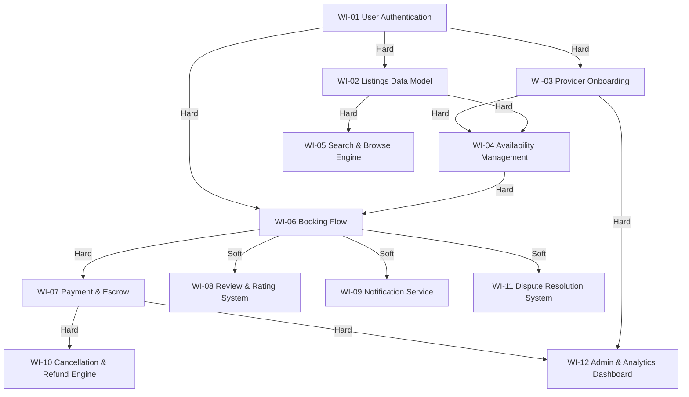

# SkillSwap - Dependency Graph (Module 02 - DAG)

## 1. Work Items Breakdown (12 Items)

1. **WI-01: User Authentication & Auth Infrastructure** (JWT, RBAC roles: Learner, Provider, Admin)
2. **WI-02: Listings Data Model & Schema** (Provider profiles, skill categories, service pricing, descriptions)
3. **WI-03: Provider Onboarding & Vetting Workflow** (Document submission, verification state machine, admin review)
4. **WI-04: Availability & Slot Schedule Management** (Slot allocation, duration settings, collision detection)
5. **WI-05: Instant Search & Browse Engine** (Category filters, geo/city sorting, <200ms latency target)
6. **WI-06: Booking Flow & State Machine** (Slot booking, state transitions: pending, confirmed, cancelled, completed)
7. **WI-07: Payment & Escrow Processing** (Stripe/Payment gateway integration, hold funds, 15% platform fee deduction)
8. **WI-08: Review & Rating System** (Learner rating/feedback, provider no-show reporting mechanism)
9. **WI-09: Notification & Messaging Service** (Booking confirmations, reminders, cancellation alerts via email/webhooks)
10. **WI-10: Cancellation & Refund Engine** (24-hour 100% platform refund baseline, provider policy fallback, no-show override)
11. **WI-11: Dispute Escalation & Resolution System** (Dispute filing, evidence collection, admin manual payout adjustments)
12. **WI-12: Platform Admin & Operational Analytics Dashboard** (KPI tracking, conversion metrics, provider approval management)

---

## 2. Visual Dependency Graph (Mermaid DAG)

---

## 3. Dependency Edge Classifications (Hard vs Soft)

| Source Work Item | Target Work Item | Dependency Type | Technical Justification |
|---|---|---|---|
| WI-01 User Authentication | WI-02 Listings Data Model | Hard (H) | Profiles must attach to authenticated user/provider IDs. |
| WI-01 User Authentication | WI-03 Provider Onboarding | Hard (H) | Onboarding applicants require authenticated identities. |
| WI-02 Listings Data Model | WI-04 Availability Management | Hard (H) | Time slots must belong to a defined provider listing schema. |
| WI-02 Listings Data Model | WI-05 Search & Browse Engine | Hard (H) | Search indices require provider data schema to query against. |
| WI-03 Provider Onboarding | WI-04 Availability Management | Hard (H) | Providers must complete vetting before opening availability slots. |
| WI-04 Availability Management | WI-06 Booking Flow | Hard (H) | Cannot execute a booking without validated, open availability slots. |
| WI-01 User Authentication | WI-06 Booking Flow | Hard (H) | Bookings require buyer (Learner) authentication. |
| WI-06 Booking Flow | WI-07 Payment & Escrow | Hard (H) | Payment transaction requires a valid pending booking reference. |
| WI-06 Booking Flow | WI-08 Review & Rating System | Soft (S) | Reviews can be developed/tested with stubbed completed bookings. |
| WI-06 Booking Flow | WI-09 Notification Service | Soft (S) | Notifications enhance UX but booking state succeeds without live emails. |
| WI-07 Payment & Escrow | WI-10 Cancellation & Refund Engine | Hard (H) | Refund calculations require ledger payment records to reverse/credit. |
| WI-06 Booking Flow | WI-11 Dispute Resolution System | Soft (S) | Dispute UI/workflow can be tested with mock booking IDs. |
| WI-03 Provider Onboarding | WI-12 Admin & Analytics Dashboard | Hard (H) | Admin dashboard must review pending provider applications. |
| WI-07 Payment & Escrow | WI-12 Admin & Analytics Dashboard | Hard (H) | Operational analytics dashboard aggregates platform fee transactions. |

---

## 4. Graph Topology Analysis

### Starting Points (In-Degree = 0)
- **WI-01: User Authentication & Auth Infrastructure** (Root dependency for all user-facing services)

### Endpoints (Out-Degree = 0)
- **WI-05: Instant Search & Browse Engine**
- **WI-08: Review & Rating System**
- **WI-09: Notification & Messaging Service**
- **WI-10: Cancellation & Refund Engine**
- **WI-11: Dispute Escalation & Resolution System**
- **WI-12: Platform Admin & Operational Analytics Dashboard**

### Critical Path (Longest Hard-Dependency Chain)
`WI-01 (Auth) -> WI-02 (Data Model) -> WI-04 (Availability) -> WI-06 (Booking) -> WI-07 (Payment) -> WI-10 (Cancellation/Refund)` (Depth = 6 stages)

---

## 5. Circular Dependency Resolution (Cycle Decoupling Strategy)

- **Identified Cycle**: `Provider Vetting (WI-03) -> Admin Dashboard (WI-12) -> Provider Data (WI-02) -> Provider Vetting (WI-03)`
- **Architectural Fix**:
  1. **Decouple Provider Data Registration**: Allow providers to create profile data (WI-02) with status `pending_verification` prior to onboarding review.
  2. **Introduce Interim CLI/API Admin Endpoint**: Enable admin vetting (WI-03) via direct REST/CLI approval endpoints prior to full Admin Dashboard UI (WI-12) completion.
  3. **Linearized DAG Flow**: `WI-01 (Auth) -> WI-02 (Pending Provider Data) -> WI-03 (Onboarding Vetting) -> WI-12 (Admin Dashboard UI)`
